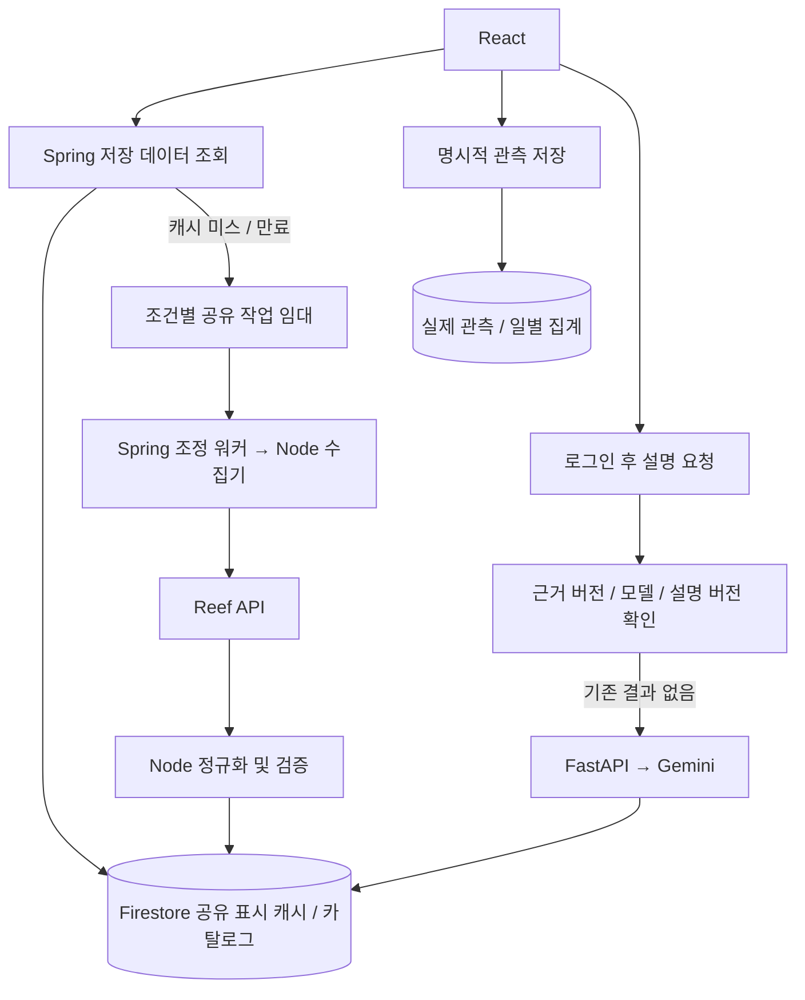

# 실제 API 중복 수집 및 분석 비용 보완 — 2026-10-23

사용자가 첨부한 외부 API 호출 최소화 제안서를 기준으로 실제 다나와 경로를 수정했다. 실행·테스트·유료 API 호출·Firestore 배포는 수행하지 않았다. 아래는 작성한 코드의 동작과 사용자 검증 안내이며, 성능 달성 보고가 아니다.

## 기존 경로 확인

기존 실제 화면은 브라우저 검색 캐시(15분)와 Node 메모리 캐시(60초)만 사용했다. Spring의 기존 CollectionJobs, ProductCache, CATALOG_SOURCE=snapshot, 분석 작업/스냅샷 선택은 fixture 카탈로그용이다. 실제 상품에 연결되지 않은 이 경로를 실제 데이터인 것처럼 재사용하지 않았다. 실제용 LiveDataCache를 기존 DanawaClient 앞에 연결했다. Node는 기존 내부 HTTP 수집 서비스를 유지한다.



## 적용한 동작

- 홈은 GET /api/v1/danawa/catalog로 실제 저장 카탈로그를 읽는다. 브라우저의 유효한 검색 결과도 유지한다. 빈 저장소에서 홈페이지 진입만으로 외부 검색/분석을 시작하지 않는다.
- 카테고리는 GET /danawa/categories의 서버 허용 목록과 검색어를 사용한다. 선택 시 해당 그룹의 저장 카탈로그를 우선 읽고, 없을 때 검색 수집 작업을 요청한다. 관련 키워드를 직접 누르는 동작은 해당 키워드 검색이다.
- 카테고리는 공급자의 실제 분류 코드라고 가정하지 않는다. 검색 수집 시 연결된 서비스 탐색 그룹이며 여러 그룹에 속할 수 있다. 홈/그룹 목록은 최근 수집된 최대 40개이고, 인기도나 AI 추천 순위를 주장하지 않는다.
- 검색어 앞뒤/중복 공백을 정규화하고, 검색어·페이지·탐색 그룹·수집 종류로 캐시 키를 나눈다. 현재 공급자 정렬은 popular로 고정이며 다른 정렬은 지원하지 않는다. 프론트엔드의 검색/카테고리 변경은 350ms 동안 합친다.
- POST /danawa/search, /product, /offers는 Firestore를 우선 읽는다. 유효 결과는 외부 호출 없이 반환한다. 자료가 없으면 202와 작업 ID를, 만료된 결과가 있으면 이전 결과와 갱신 상태를 반환한다.
- 프론트엔드는 /danawa/jobs/{jobId}로 상태만 재조회한다. 상태 GET은 수집을 새로 만들지 않는다. 최대 약 45초 기다린 뒤에도 대기 중이면 상태 확인 안내를 제공한다. 대기와 실제 빈 검색 완료를 구분한다.
- 저장된 상세 이미지는 공유 카탈로그에도 보관한다. 검색 결과의 누락 이미지에 이미 확보한 URL을 보완하며, 이 보완은 새로운 Reef 호출이나 가격 관측을 만들지 않는다.
- 표시용 검색/상세/판매처 캐시 저장은 관측 원장에 쓰지 않는다. 명시적인 관측 저장은 공유 판매처 자료의 원본 시각을 유지하고 기존 멱등 정책으로 기록한다. 갱신 중인 만료 자료는 저장을 보류한다.
- 저장 관측의 history 응답에 currency, observedDays, coverageStart/End, dataVersion을 추가했다. 기존 일별 카드 표시가 표본과 판단 적격 표본의 차이는 유지한다. 미관측 날짜를 채우지 않는다.
- Gemini는 옵션·실제 관측 데이터 버전·모델·규칙/설명 버전을 캐시 키에 포함한다. 동일 키의 성공 결과가 남아 있으면 시간 경과만으로 재호출하지 않는다. 캐시 조회에서는 사용자 분석 할당량도 소비하지 않는다.
- Gemini 작업 실패 시 같은 근거의 기존 결과를 우선하고, 없으면 model=server-rule-only / explanationSource=SERVER_FALLBACK 안내를 반환한다. BUY/WAIT를 만들어내지 않고 구매 판단 보류를 유지한다.

## 공유 작업과 실패 처리

Firestore liveDisplayCache 문서에서 트랜잭션으로 소유권 토큰과 임대를 획득한다. 동일 키를 요청하는 다른 서버는 기존 결과 또는 진행 중 작업을 받는다. 실행 시작 시 120초 임대를 갱신하고, 결과 저장 시 소유권과 임대 유효성을 다시 확인한다. 외부 HTTP 호출 중에는 Firestore 트랜잭션을 유지하지 않는다.

워커는 API 프로세스당 2개이고 대기/재시도 포함 최대 32개 작업을 수용한다. 수집기는 기존 60초당 20회/동시 4개 제한을 유지한다. 일시적 503은 2초·4초 간격, 429는 60초 간격으로 최대 총 3회 시도한다. 응답 형식 오류는 자동 재시도하지 않는다. Gemini는 자동 재시도하지 않는다. 이미 외부 결과를 받은 뒤 DB 저장이 실패했다는 이유로 같은 워커에서 외부 HTTP를 다시 호출하지 않는다.

큐 부족/최종 실패에는 짧은 재요청 대기 시간을 적용한다. 프로세스 종료로 중단된 작업은 임대 만료 후 같은 조건을 다시 요청하면 회복할 수 있다. 현재는 외부 큐 데몬이 모든 중단 작업을 독립적으로 복구하는 구조는 아니다. 장애 경계에서 공급자가 응답하기 전에 연결이 끊기는 경우 등 외부 과금의 정확히 한 번 실행을 보장하지는 않는다.

Firestore 장애 때 외부 직접 호출로 우회하지 않는다. 중복 수집 방지 없이 비용이 발생하지 않도록 저장소 오류를 반환한다.

## 초기 보관 정책

| 대상 | 기본값 | 비고 |
|---|---|---|
| 브라우저 검색 결과 | 15분 | 최대 20개 페이지, 기존 방식 유지 |
| 공유 검색 결과 | 15분 | LIVE_SEARCH_CACHE_SECONDS=900 |
| 상품 상세/기본 정보 | 6시간 | LIVE_PRODUCT_CACHE_SECONDS=21600 |
| 판매처 표시 자료 | 5분 | LIVE_OFFERS_CACHE_SECONDS=300 |
| Gemini 설명 | 동일 근거·모델·버전 동안 재사용 | 시간만으로 재생성하지 않음 |
| 공유 캐시 정리 기준 | 마지막 요청 후 30일 retireAt | Firestore TTL 정책은 별도 설정 필요 |

상품 상세의 표시 가격은 기본 정보 캐시에 포함되며, 최신 결제 비교는 별도의 판매처 갱신을 사용한다. 가격 시각이 없거나 검색/상세 표시 가격이 15분, 판매처 가격이 5분보다 오래되면 이전 표시가/시각 미확인 안내를 표시한다. 보관 유효 기간과 관측 시각은 별개다. Firestore TTL은 코드가 자동으로 켜지 않으며 기존 데이터도 삭제하지 않았다.

## 정기 수집 — 기본 꺼짐

LIVE_REFRESH_ENABLED=false가 기본이다. 명시적으로 true로 설정하면 실행 후 기본 6시간마다 최근 수집 카탈로그의 최대 5개 상품에 대해 판매처 갱신과 실제 관측 저장을 요청한다. 여러 API 인스턴스에서도 같은 키의 공유 임대를 사용한다. 캐시 적중을 새로운 관측으로 만들지 않는다.

이 주기는 비용이 발생할 수 있으므로 이번 작업에서 활성화하지 않았다. 찜·목표가·조회수에 따른 상세 우선순위, 알림 평가 연결, 오래된 상품의 전체 수집 정책은 아직 실제 상품에 연결하지 않았다. 중고·무신사 공급자도 이번 대상이 아니다.

## 반영 순서 — 사용자 직접 실행

1. Firebase 기본 프로젝트와 서비스 계정 설정을 유지한다. CATALOG_SOURCE는 기존 fixture 비활성 어댑터 설정값을 유지하며 snapshot으로 바꾸지 않는다.
2. 카테고리 조회용 복합 인덱스를 실제 프로젝트에 반영한다. 실제 Firestore 인덱스가 준비될 때까지 기다린다.

```powershell
cd D:\github\codyssey_final\firebase
firebase deploy --only firestore:indexes --project '<실제 Firebase 프로젝트 ID>'
```

위 명령은 사용자가 실행한다. 현재 프로젝트가 demo-prizm으로 저장되어 있을 수 있으므로 --project에 실제 ID를 명시한다. 변경된 규칙 배포나 비공개 키를 채팅에 제공할 필요는 없다.

3. Spring Boot와 Node 수집기를 재시작하고 프론트엔드를 새로고침한다. FastAPI의 기존 Gemini 설정은 유지한다. 정기 수집은 기본 꺼짐으로 둔다.
4. 이전 브라우저 캐시로 서버에 자료가 아직 저장되지 않았다면 결과 다시 조회를 한 번 눌러 실제 공유 캐시/카탈로그를 생성한다. 이때 실제 Reef 크레딧이 발생할 수 있다.

## 직접 검증할 시나리오

- 홈 진입/새로고침: Network에 catalog/categories 조회는 있어도 외부 search 작업이 자동 시작되지 않아야 한다.
- 최초 검색: 202 → QUEUED/RUNNING → 저장 결과를 받는지 확인한다. 실제 빈 결과는 수집 성공 후 items=[]일 때만 표시한다.
- 같은 검색어를 다른 브라우저에서 동시에 요청: liveDisplayCache의 키/소유자/상태와 Node upstreamRequests를 확인한다. 일반 상황에서 같은 작업을 하나로 합쳐야 한다.
- 같은 카테고리 재방문: 자료가 있으면 저장 카탈로그만 읽는지 확인한다. 새 키워드는 별도 수집 조건으로 취급한다.
- 같은 상세 재방문: 유효한 공유 캐시가 있으면 Node 외부 요청 횟수가 늘지 않아야 한다.
- 만료/오류: 이전 자료의 원본 시각과 stale/갱신 안내를 표시하고 가격을 새 관측으로 간주하지 않아야 한다.
- 관측 저장: 공유 판매처 자료를 반복 저장해도 관측 ID/일 표본이 중복 증가하지 않는지 확인한다. 갱신 중이면 저장 안내를 확인한다.
- Gemini: 같은 근거·모델로 두 번 요청하여 두 번째 요청이 모델/할당량을 소비하지 않는지 확인한다. 근거/모델/버전이 바뀌면 새 키가 생성되어야 한다. 설명 작업은 공개 jobs 경로로 읽을 수 없어야 한다.
- 노드 또는 FastAPI 중단: 이전 유효 결과/서버 기본 설명과 오류 상태가 구분되는지 확인한다.
- 다중 서버/강제 종료: 임대 소유권 교체 후 이전 작업이 결과를 덮어쓰지 않는지, 임대 만료 후 재요청으로 회복하는지 확인한다.

## 지표

운영 UID로 인증한 GET /api/v1/me/danawa/live-metrics에서 확인한다.

- sharedCache: 최근 요청한 최대 100개 캐시 키의 누적 requests/hits/merged/successes/failures 및 종류별 합계. 전체 서비스의 무제한 누적 집계는 아니다.
- http: 현재 Spring 프로세스의 경로별 요청/오류 횟수와 최근 최대 256개 응답 시간 p95. 작업 상태 폴링도 별도 경로로 집계한다.
- collector: 현재 Node 프로세스의 실제 Reef 외부 시도 횟수, 유형별 횟수, 성공/실패, 캐시 적중/병합, 최근 최대 200개 외부 응답 시간 p95. API에서 내부 인증으로 가져오며 브라우저에 내부 키를 노출하지 않는다.
- 실제 청구 크레딧은 공급자 정산을 확인하지 않았으므로 actualCreditUsage=null이다. 외부 요청 횟수를 청구액으로 환산하지 않는다.

저장 데이터 API p95 1초 이하는 검증 목표이며 달성을 확인하지 않았다. Firebase 최초 연결, 인덱스, 리전, 조회/트랜잭션 및 카탈로그 이미지 보완 읽기 비용을 포함해 사용자 환경에서 측정해야 한다. 다중 Node 프로세스의 합산 외부 호출 한도/장기 지표 보관과 FastAPI의 별도 실제 Gemini 전송 카운터는 추가 운영 작업이다.

## 검증 명령과 작성한 테스트 소스

```powershell
# backend/api
mvn test
# backend/collector
npm test
# frontend
npm run build
```

사용자가 서비스별 디렉터리에서 실행한다. 공유 캐시 적중, 활성 임대에서 중복 실행 생략, 키 분리, 동일 근거 설명의 재사용, 설명 작업의 공개 접근 차단, 원본 관측 저장, Node 실제 요청/캐시 지표 테스트 소스를 추가했다. 테스트를 실행하거나 통과를 확인한 것은 아니다.
